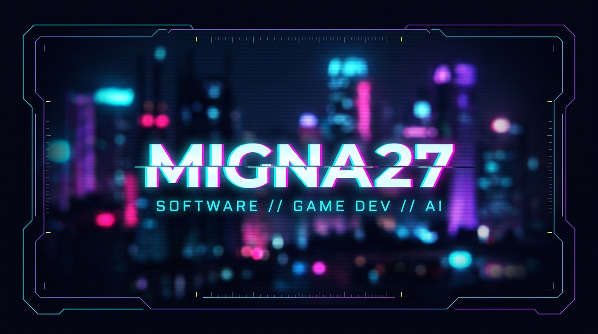
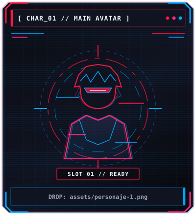
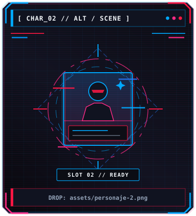
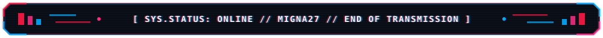

<p align="center">
  
</p>

<p align="center">
  
</p>

<p align="center">
  
  
  
</p>

<p align="center">
  
</p>

### `[ 01 // PERFIL DEL JUGADOR ]`

```yaml
player:
  nombre: "Miguel Osvaldo García Montoya"
  alias: "migna27"
  rol: "Estudiante de Ingeniería en Software & Desarrollador"
  intereses:
    - "Programación & creación de herramientas digitales"
    - "Desarrollo colaborativo de videojuegos & narrativa visual"
    - "Integración de IA & generación de contenido"
```

> *Me apasiona la programación, la creación de herramientas digitales, la integración de IA y el desarrollo colaborativo de videojuegos.*

<p align="center">
  
</p>

### `[ 02 // EQUIPAMIENTO & TECH STACK ]`

<table align="center" width="100%">
  <tr>
    <td align="center" width="50%" valign="top">
      <strong>💻 Desarrollo &amp; Backend</strong><br /><br />
      
      
    </td>
    <td align="center" width="50%" valign="top">
      <strong>🌐 Tecnologías Web</strong><br /><br />
      
      
      
    </td>
  </tr>
  <tr>
    <td align="center" width="50%" valign="top">
      <strong>🎮 Videojuegos &amp; Narrativa Visual</strong><br /><br />
      
      
      
    </td>
    <td align="center" width="50%" valign="top">
      <strong>🤖 IA &amp; Generación de Contenido</strong><br /><br />
      
      
      
      
    </td>
  </tr>
  <tr>
    <td align="center" colspan="2">
      <strong>🎨 Diseño &amp; Herramientas de Desarrollo</strong><br /><br />
      
      
      
      
    </td>
  </tr>
</table>

<p align="center">
  
</p>

### `[ 03 // PERSONAJE & GALERÍA VISUAL ]`

<!--
  CÓMO AGREGAR LAS IMÁGENES DE TU PERSONAJE:
  1. Guarda tus archivos (PNG, JPG, WebP o GIF) dentro de la carpeta ./assets/
     por ejemplo: ./assets/personaje-1.png y ./assets/personaje-2.png
  2. Cambia los atributos src="./assets/personaje-slot-1.svg" y src="./assets/personaje-slot-2.svg"
     por tus nuevos archivos.
  3. Si quieres mostrar una 3.ª imagen, solo agrega otro <td>...</td> dentro del <tr>.
-->

<table align="center">
  <tr>
    <td align="center">
      <br />
      <sub><code>CHAR_01 // AVATAR PRINCIPAL</code></sub>
    </td>
    <td align="center">
      <br />
      <sub><code>CHAR_02 // ESCENA / VARIACIÓN</code></sub>
    </td>
  </tr>
</table>

<p align="center">
  
</p>

### `[ 04 // TELEMETRÍA DE GITHUB ]`

<p align="center">
  <a href="https://git.io/streak-stats">
    
  </a>
</p>

<p align="center">
  
</p>
