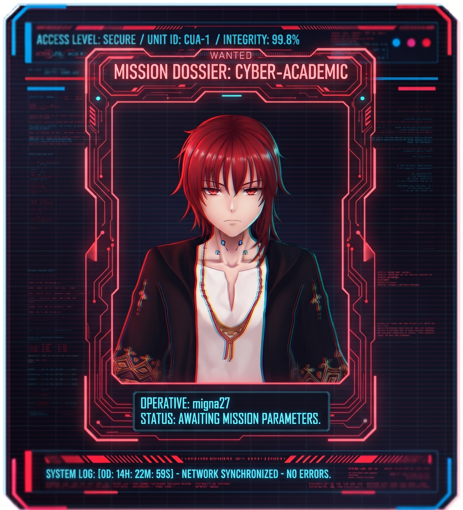
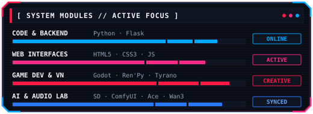
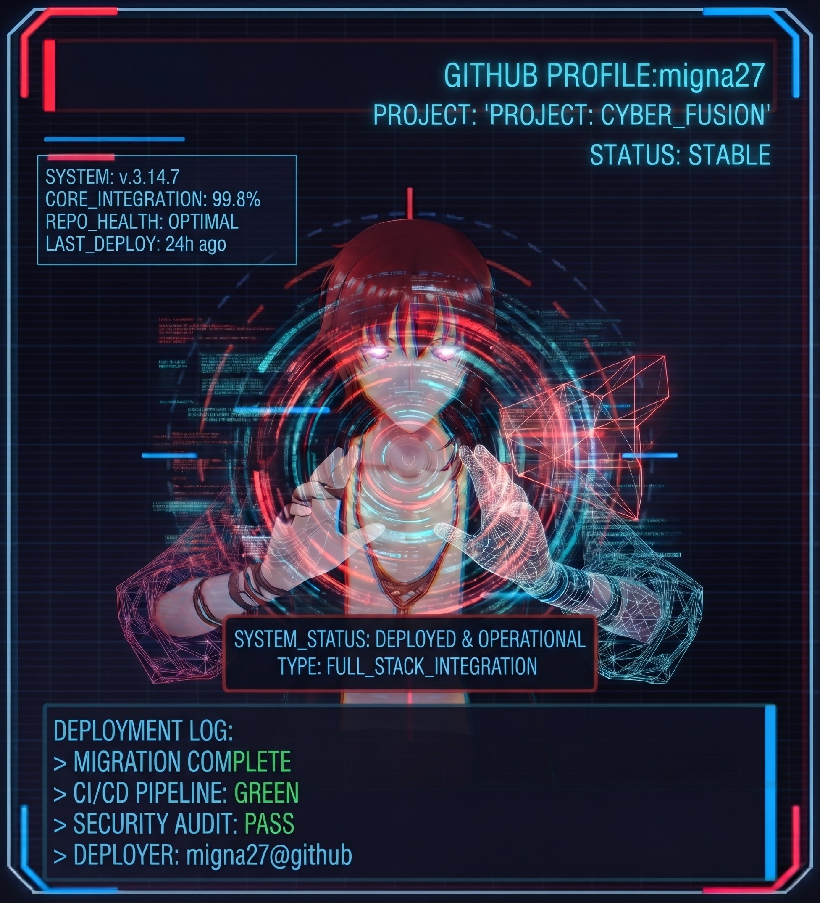
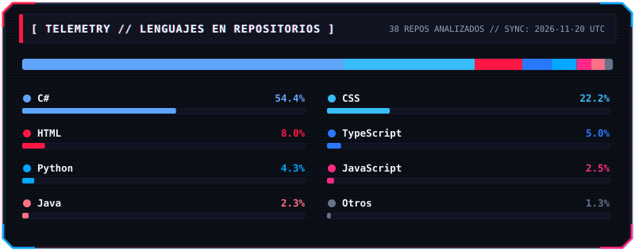
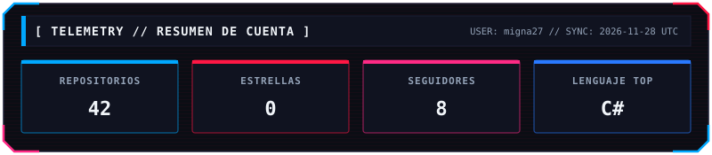

  

  

  
  
  
  
  

  

### `[ 01 // EXPEDIENTE DEL OPERATIVO ]`

<table align="center" width="100%">
  <tr>
    <td align="center" width="310" valign="middle">
       
      <code>UNIT_ID: CUA-1 // MISSION DOSSIER</code>
    </td>
    <td valign="top">
      <pre><code>player:
  nombre: "Miguel Osvaldo García Montoya"
  alias: "migna27"
  rol: "Estudiante de Ingeniería en Software &amp; Desarrollador"
  intereses:
    - "Programación &amp; creación de herramientas digitales"
    - "Desarrollo colaborativo de videojuegos &amp; narrativa visual"
    - "Integración de IA &amp; generación de contenido"</code></pre>
      <blockquote><em>Me apasiona la programación, la creación de herramientas digitales, la integración de IA y el desarrollo colaborativo de videojuegos.</em></blockquote>
      
    </td>
  </tr>
</table>

  

### `[ 02 // EQUIPAMIENTO & TECH STACK ]`

<table align="center" width="100%">
  <tr>
    <td align="center" width="50%" valign="top">
      <strong>💻 Desarrollo &amp; Backend</strong>  
      
      
    </td>
    <td align="center" width="50%" valign="top">
      <strong>🌐 Tecnologías Web</strong>  
      
      
      
    </td>
  </tr>
  <tr>
    <td align="center" width="50%" valign="top">
      <strong>🎮 Videojuegos &amp; Narrativa Visual</strong>  
      
      
      
    </td>
    <td align="center" width="50%" valign="top">
      <strong>🤖 IA &amp; Generación de Contenido</strong>  
      
      
      
      
    </td>
  </tr>
  <tr>
    <td align="center" colspan="2">
      <strong>🎨 Diseño &amp; Herramientas de Desarrollo</strong>  
      
      
      
      
    </td>
  </tr>
</table>

  

### `[ 03 // NÚCLEO CREATIVO & ÁREAS DE MISIÓN ]`

<table align="center" width="100%">
  <tr>
    <td valign="top">
      <strong><code>[ MOD_01 ]</code> Desarrollo &amp; Herramientas Digitales</strong> 
      Aplicaciones web y utilidades prácticas construidas con <code>Python</code>, <code>Flask</code>, <code>HTML5</code>, <code>CSS3</code> y <code>JavaScript</code>.  
      <strong><code>[ MOD_02 ]</code> Videojuegos &amp; Narrativa Visual</strong> 
      Diseño colaborativo de juegos y novelas visuales interactivas con <code>Godot Engine</code>, <code>Ren'Py</code> y <code>TyranoBuilder</code>.  
      <strong><code>[ MOD_03 ]</code> Pipelines de IA &amp; Audio Creativo</strong> 
      Generación visual, flujos nodales y síntesis vocal mediante <code>Stable Diffusion</code>, <code>ComfyUI</code>, <code>Ace Studio</code> y <code>Wan3 TTS</code>.  
      <strong><code>[ MOD_04 ]</code> Diseño Visual &amp; Flujo de Trabajo</strong> 
      Edición gráfica en <code>Photoshop</code> y control de versiones limpio con <code>VS Code</code>, <code>Git</code> y <code>GitHub</code>.
    </td>
    <td align="center" width="310" valign="middle">
       
      <code>PROJECT: CYBER_FUSION // DEPLOYED &amp; OPERATIONAL</code>
    </td>
  </tr>
</table>

  

### `[ 04 // PORCENTAJE DE LENGUAJES EN REPOSITORIOS ]`

  

  
<code>[ INFO // Cómo se calcula y actualiza automáticamente esta telemetría ]</code>

   
  <ul>
    <li>El flujo <a href="./.github/workflows/update-stats.yml"><code>update-stats.yml</code></a> ejecuta <a href="./scripts/update_stats.py"><code>scripts/update_stats.py</code></a> automáticamente cada día y en cada push a <code>main</code>.</li>
    <li>Consulta la API de GitHub y suma los <strong>bytes de código por lenguaje</strong> de todos tus repositorios propios (excluyendo forks y el repo de perfil <code>migna27/migna27</code>) para calcular el <strong>porcentaje exacto</strong>.</li>
    <li><strong>¿Quieres incluir también tus repositorios privados?</strong> Crea un Personal Access Token con permiso de lectura a repositorios y guárdalo en <code>Settings &gt; Secrets and variables &gt; Actions</code> como <code>METRICS_TOKEN</code>.</li>
  </ul>

  

### `[ 05 // TELEMETRÍA & ACTIVIDAD DE GITHUB ]`

  

  

  

### `[ 06 // CANAL DE CONEXIÓN & COLABORACIÓN ]`

  <strong>¿Trabajamos en un juego indie, novela visual, herramienta digital o flujo con IA?</strong>

  
  

<!--
  OPCIONAL — Agrega aquí tus enlaces sociales reales cuando quieras mostrarlos:
  

    
    
    
  

-->

  

